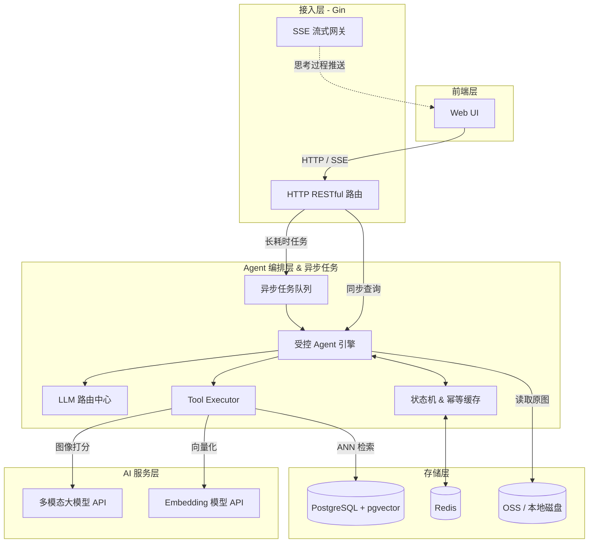

# PicMind

> 基于 Go + 多模态大模型 (Vision-LLM) 的智能影像管家 Agent


## 项目简介

**PicMind** 是一个 AI 原生 (AI-Native) 的多模态影像管家。项目利用大语言模型（LLM）与多模态大模型（Vision-LLM），理解复杂指令、自动拆解任务并执行影像相关能力（美学打分、语义搜图等）。

后端以 Go 作为中枢控制层，重点解决长耗时任务状态流转、第三方大模型 API 的高并发与防封控，以及流式交互等工程化问题。当前仓库处于脚手架阶段，核心链路尚未实现。

## 核心特性（规划）

- **受控 Agent 编排**：基于 LLM Function Calling，将扫描目录、特征提取、美学打分、向量检索封装为 Tools；结合 JSON Schema 校验与最大步数限制，保障执行稳定性。
- **高并发与容灾降级**：令牌桶限流 + `errgroup` 并发控制；指数退避重试与多模型降级（如 Qwen-VL → GLM-4V）。
- **SSE 流式交互**：Server-Sent Events + Go Channel，向前端实时推送 Agent 思考过程。
- **RAG 语义召回**：Text-Embedding API + `pgvector`，支持自然语言搜图（ANN）。
- **幂等与降本**：图片 MD5 + 模型版本生成 Cache Key，结合 Redis 优先读缓存，降低 Token 成本。

## 系统架构（规划）

采用模块化单体 (Modular Monolith)，前后端分离，Monorepo 管理。



## 技术栈（规划）

| 分类 | 技术选型 |
| :--- | :--- |
| 后端语言 | Go |
| Web 框架 | Gin |
| AI 集成 | Vision-LLM（Qwen-VL / GLM-4V）、Text-Embedding |
| 数据存储 | PostgreSQL（pgvector）、Redis |
| 前端 | 待定（`frontend/` 目录已预留） |
| 部署 | Docker / Docker Compose / Nginx（待引入） |

## 当前目录结构

```text
PicMind/
├── backend/
│   └── cmd/
│       └── main.go          # 后端入口（脚手架）
├── frontend/                # 前端目录（空，待初始化）
├── LICENSE
└── README.md
```

后续计划逐步补齐：`internal/`、`pkg/`、`go.mod`、部署配置与文档等。

## 环境要求

- Go **1.22+**（本机当前为 Go 1.26）
- 后续依赖：PostgreSQL（含 pgvector）、Redis、可用的 Vision-LLM / Embedding API Key

## 开发路线图

- [x] **脚手架**：初始化 Monorepo（`backend/` / `frontend/`）、仓库与 README
- [ ] **P0 - 基础架构**：`go.mod`、Gin 服务骨架、配置与 Docker 依赖
- [ ] **P0 - 核心链路**：受控 Agent 链路，单图美学打分接口
- [ ] **P1 - RAG 与流式交互**：pgvector 文本搜图，SSE 进度推送
- [ ] **P1 - 工程化保障**：限流、降级重试、幂等缓存
- [ ] **P2 - 进阶能力**：Agent Memory、前端可视化 UI

## 快速开始

当前仅有空入口文件，尚不可运行完整服务。初始化后端模块后可参考：

```bash
cd backend
go mod init github.com/echo404s/PicMind/backend   # 首次初始化
go run ./cmd
```

更完整的启动、环境变量与 Docker 说明将在基础架构落地后补充。

## 开源协议

本项目基于 [MIT License](LICENSE) 开源。
